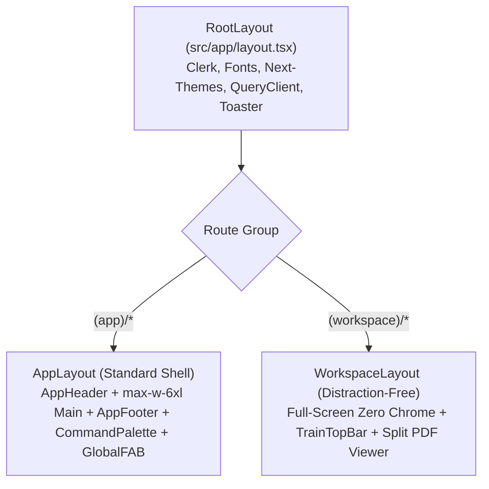

# Hinthar Education (E2E) — Design System Specification

## 1. Overview

The Hinthar Education E2E platform is an academic community engine combining creator-led curriculum courses, peer problem-solving (Solve!), past-paper training (Train!), and moderated academic discourse.

### Design Modes

1. **Operate Mode (`Dashboard`, `Forum`, `Solve!`, `Train!`, `Admin & Moderation`)**
   - **Primary Objective:** Help students, mentors, and administrators execute tasks with high velocity, spatial clarity, and keyboard predictability.
   - **Characteristics:** Dense information architecture, high-contrast borders, rapid scanning affordances, explicit status badges, and zero decorative visual noise.
2. **Read Mode (`Lessons`, `Past Exam Papers`, `Study Plans`, `Knowledge Base`)**
   - **Primary Objective:** Support deep, sustained concentration and conceptual comprehension.
   - **Characteristics:** Comfortable typographic measure (65–75 characters per line), distraction-free layout, zero sidebar collisions, and generous vertical rhythm.

### Aesthetic Direction: Swiss Academic Clean

- **Philosophy:** Content-first clarity derived from International Typographic Style (Swiss Style). High contrast, asymmetric balance, disciplined typographic hierarchy, and structural border lines.
- **Color Discipline:** Deep Slate Navy primary anchor with calibrated Emerald/Teal academic accents (`oklch(0.508 0.118 165.612)`).
- **Calibrated Dark Mode:** Slate Navy dark backdrop (`oklch(0.148 0.004 228.8)`) with elevated card surfaces (`oklch(0.20 0.008 225)`), avoiding pitch black or washed-out grays.
- **Absolute Restraint:** No neon drop shadows, no glassmorphism for arbitrary decoration, no emoji standing in for icons, and no zero-blur neobrutalist block shadows.

---

## 2. Colors

All colors are defined in the modern **OKLCH** color space to guarantee perceptual uniformity, predictable chroma, and reliable contrast across both light and dark themes.

### 2.1 Core Semantic Token Palette

| Token Name | Light Mode (Hex / OKLCH) | Dark Mode (Hex / OKLCH) | Purpose & Usage |
| :--- | :--- | :--- | :--- |
| `background` | `oklch(0.99 0.002 220)` | `oklch(0.148 0.004 228.8)` | Page root background |
| `foreground` | `oklch(0.18 0.015 230)` | `oklch(0.97 0.005 220)` | Primary high-contrast text |
| `card` | `oklch(1 0 0)` | `oklch(0.20 0.008 225)` | Elevated surface for content items |
| `card-foreground` | `oklch(0.18 0.015 230)` | `oklch(0.97 0.005 220)` | Text inside cards |
| `primary` | `oklch(0.508 0.118 165.612)` | `oklch(0.58 0.125 165)` | Brand academic emerald/teal |
| `primary-foreground` | `oklch(0.99 0.005 166)` | `oklch(0.12 0.01 165)` | High-contrast text on primary |
| `secondary` | `oklch(0.96 0.005 220)` | `oklch(0.25 0.008 225)` | Secondary buttons, subtle fills |
| `secondary-foreground`| `oklch(0.22 0.015 230)` | `oklch(0.95 0.005 220)` | Text on secondary elements |
| `muted` | `oklch(0.955 0.005 220)` | `oklch(0.24 0.008 225)` | Inactive pills, skeleton loaders |
| `muted-foreground` | `oklch(0.50 0.015 220)` | `oklch(0.68 0.012 220)` | Subtitles, timestamps, captions ($\ge 4.5:1$) |
| `border` | `oklch(0.91 0.005 220)` | `oklch(0.28 0.008 225)` | Structural dividers, card borders |
| `ring` | `oklch(0.508 0.118 165.612)` | `oklch(0.58 0.125 165)` | Accessible keyboard focus indicator |
| `destructive` | `oklch(0.58 0.22 25)` | `oklch(0.65 0.20 25)` | Errors, bans, destructive deletions |
| `warning` | `oklch(0.72 0.16 70)` | `oklch(0.75 0.16 70)` | Expiration badges (30d TTL), warnings |

### 2.2 Contributor Tier Progression Palette

The platform features 5 distinct contributor tiers governing community peer-review authority and dynamic vote weights ($1\times$ to $5\times$). Each tier has dedicated light and dark tokens:

| Tier | Level Name | Vote Multiplier | Light Badge (Text / Bg) | Dark Badge (Text / Bg) |
| :---: | :--- | :---: | :--- | :--- |
| **Tier 0** | Novice / Contributor | $1\times$ | `oklch(0.55 0.015 220)` / `oklch(0.96 0.005 220)` | `oklch(0.70 0.015 220)` / `oklch(0.24 0.01 220)` |
| **Tier 1** | Bronze Explorer | $2\times$ | `oklch(0.62 0.16 65)` / `oklch(0.96 0.04 65)` | `oklch(0.75 0.16 65)` / `oklch(0.26 0.05 65)` |
| **Tier 2** | Silver Solver | $3\times$ | `oklch(0.58 0.15 230)` / `oklch(0.95 0.04 230)` | `oklch(0.72 0.15 230)` / `oklch(0.25 0.05 230)` |
| **Tier 3** | Gold Master | $4\times$ | `oklch(0.55 0.18 150)` / `oklch(0.95 0.04 150)` | `oklch(0.70 0.18 150)` / `oklch(0.24 0.05 150)` |
| **Tier 4** | Scholar Fellow | $5\times$ | `oklch(0.52 0.22 300)` / `oklch(0.95 0.05 300)` | `oklch(0.70 0.22 300)` / `oklch(0.26 0.06 300)` |

### 2.3 Contrast Guarantees

- **Normal Text ($\le 18\text{pt}$ / $24\text{px}$):** Contrast ratio $\ge 4.5:1$ against card and background surfaces.
- **Large Text ($> 18\text{pt}$ / $24\text{px}$ bold):** Contrast ratio $\ge 3:1$.
- **UI Components & Borders:** Contrast ratio $\ge 3:1$ against adjacent background colors for clear visual boundaries.

---

## 3. Typography

The typography pipeline pairs **Manrope** for authoritative, geometric academic headings with **Montserrat** for clean, legible body text and UI controls.

### 3.1 Typeface Roles

- **Headings & Display (`--font-heading`):** `Manrope` (weights: `600` SemiBold, `700` Bold).  
  *Style Rule:* Negative tracking (`-0.02em` to `-0.025em`) for tight, confident headers.
- **Body & UI Elements (`--font-sans`):** `Montserrat` (weights: `400` Regular, `500` Medium, `600` SemiBold).  
  *Style Rule:* Normal tracking with generous line height (`1.5` to `1.65`) for effortless reading.
- **Code & Math (`--font-mono`):** `Geist Mono` (weights: `400` Regular, `500` Medium).  
  *Style Rule:* Used for KaTeX math notation, hotkey badges (`⌘K`), past paper codes (`9709/12/M/J/23`), and timestamps.

### 3.2 Typographic Hierarchy Scale

| Semantic Role | Desktop Classes | Mobile Classes | Weight & Tracking | Line Height |
| :--- | :--- | :--- | :--- | :--- |
| **Hero / H1** | `text-4xl` ($36\text{px}$) | `text-3xl` ($30\text{px}$) | `font-heading font-bold tracking-tight` | `leading-[1.15]` |
| **Section / H2**| `text-3xl` ($30\text{px}$) | `text-2xl` ($24\text{px}$) | `font-heading font-semibold tracking-tight` | `leading-[1.2]` |
| **Subset / H3** | `text-xl` ($20\text{px}$) | `text-lg` ($18\text{px}$) | `font-heading font-semibold` | `leading-[1.3]` |
| **Card Title** | `text-lg` ($18\text{px}$) | `text-base` ($16\text{px}$) | `font-heading font-semibold` | `leading-[1.35]` |
| **Body (Default)**| `text-sm` ($14\text{px}$) | `text-sm` ($14\text{px}$) | `font-sans font-normal` | `leading-relaxed` ($1.6$) |
| **Small / Meta** | `text-xs` ($12\text{px}$) | `text-xs` ($12\text{px}$) | `font-sans font-medium` | `leading-normal` |
| **Micro Caption**| `text-[11px]` | `text-[11px]` | `font-sans font-medium` | `leading-tight` |

---

## 4. Layout & Spatial Architecture

### 4.1 Container Hierarchy

- **Platform Max Width:** `max-w-6xl` ($1152\text{px}$), horizontally centered with `mx-auto`.
- **Horizontal Viewport Padding:** `px-4 sm:px-6`.
- **Vertical Viewport Spacing:** `py-6 sm:py-8`.
- **Rule of Single Container:** All views inherit container constraints from root `AppLayout`. Child pages must **never** wrap content in a duplicate `max-w-6xl mx-auto px-4` wrapper.

### 4.2 Dual-Shell Architecture



1. **Standard App Shell (`src/app/(app)/layout.tsx`):**
   - Sticky `AppHeader` ($64\text{px}$ height) with blur backdrop (`bg-background/90 backdrop-blur-md`).
   - Centered `main` container (`max-w-6xl mx-auto flex-1 px-4 py-6 sm:px-6`).
   - Sticky Desktop `FilterSidebar` (`w-full lg:w-64 shrink-0 lg:sticky lg:top-20`).
   - `AppFooter` with academic links, theme switcher, and version info.
2. **Distraction-Free Workspace Shell (`src/app/(workspace)/layout.tsx`):**
   - Full-screen zero-chrome viewport (`h-screen overflow-hidden flex flex-col`).
   - Dedicated `TrainTopBar`: session countdown timer, QP/MS toggle, zoom controls, and "Ask in Solve!" trigger.
   - Dual-PDF pane or curriculum accordion for uninterrupted past-paper solving.

### 4.3 Elimination of Scroll Traps & Negative Margins

- **Window-First Scrolling:** Desktop feeds must never lock the viewport with `h-[calc(100vh-160px)] overflow-y-auto`. Feeds flow down the natural DOM height, letting the browser window scroll smoothly.
- **Ban on Negative Margins:** Negative vertical margins (`-mt-3`, `-mt-4`) are strictly banned. Spacing between header, sub-nav, and feed cards is handled exclusively via natural gap utilities (`gap-6`).

---

## 5. Elevation & Depth

Rather than relying on ungrounded zero-offset colored halos or heavy drop shadows, elevation in the Swiss Academic Clean system is created through subtle structural borders and soft, directional ambient shadows.

### 5.1 Elevation Vocabulary

```css
@theme inline {
  --shadow-sm: 0 1px 2px 0 rgb(0 0 0 / 0.05);
  --shadow-card: 0 1px 3px 0 rgb(0 0 0 / 0.1), 0 1px 2px -1px rgb(0 0 0 / 0.1);
  --shadow-card-hover: 0 10px 25px -5px rgb(0 0 0 / 0.12), 0 8px 10px -6px rgb(0 0 0 / 0.08);
  --shadow-modal: 0 20px 25px -5px rgb(0 0 0 / 0.2), 0 8px 10px -6px rgb(0 0 0 / 0.1);
}
```

### 5.2 Card Border States

- **Resting:** `border border-border bg-card shadow-card`
- **Interactive Hover:** `hover:border-primary/40 hover:shadow-card-hover transition-all duration-200`
- **Active / Consensus Winning:** `border-primary ring-2 ring-primary/20`
- **Warning / Expiring Soon:** `border-warning/40 bg-warning/5`

---

## 6. Shapes & Border Radii

Consistent corner radii establish a calm, predictable visual rhythm throughout the interface:

| Token | CSS Value | Intended Elements |
| :--- | :--- | :--- |
| `rounded-sm` | `0.25rem` ($4\text{px}$) | Keyboard shortcut badges (`<kbd>`), micro indicators |
| `rounded-md` | `0.375rem` ($6\text{px}$) | SubNav tabs, small buttons, filter chips, tag badges |
| `rounded-lg` | `0.5rem` ($8\text{px}$) | Form inputs (`<Input />`), textareas, standard buttons, dropdowns |
| `rounded-xl` | `0.75rem` ($12\text{px}$) | Content cards (`<Card />`), modal dialogs, sheets |
| `rounded-2xl`| `1rem` ($16\text{px}$) | Hero banners, callout highlights |
| `rounded-full`| `9999px` | Avatars, status dots, circular icon buttons, Contributor pills |

---

## 7. Component Primitives

All UI components reside in `@/components/ui/` and adhere strictly to accessible Base-UI and Tailwind CSS standards:

1. **`<Button />`**:
   - Variants: `default`, `outline`, `secondary`, `ghost`, `destructive`, `link`.
   - Sizes: `xs` ($28\text{px}$), `sm` ($32\text{px}$), `default` ($40\text{px}$), `lg` ($48\text{px}$), `icon` ($40\times 40\text{px}$).
   - Focus ring: `focus-visible:ring-2 focus-visible:ring-primary focus-visible:ring-offset-2`.
2. **`<Input />` & `<Textarea />`**:
   - Universal replacement for `const inputClass = "..."`.
   - Error state: `aria-invalid:border-destructive aria-invalid:ring-2 aria-invalid:ring-destructive/20`.
3. **`<Field />`**:
   - Form control wrapper combining accessible label, optional/required asterisk, helper description, and animated Zod error message.
4. **`<Card />` Kit**:
   - Composable primitives: `<Card>`, `<CardHeader>`, `<CardTitle>`, `<CardDescription>`, `<CardContent>`, `<CardFooter>`.
5. **`<Badge />` & `<TagBadge />`**:
   - Semantic tags for subjects, academic levels, and topics with clickable routing to `/tags/[name]`.
6. **`<ContributorBadge />`**:
   - Displays tier title (Tier 0–4) with dedicated tier colors and tooltip showing vote multiplier ($1\times$ to $5\times$).
7. **`<EmptyState />`**:
   - Standardized dashed border (`border-dashed border-border rounded-xl bg-card/50 p-8 sm:p-12 text-center`) with icon, title, description, and primary action.
8. **`<Dialog />`**:
   - Base-UI accessible modal dialog with backdrop blur, keyboard trap, and escape key handling.

---

## 8. Do's and Don'ts

| Category | Do ✅ | Don't ❌ |
| :--- | :--- | :--- |
| **Tokens & Colors** | Use semantic utility tokens (`bg-card`, `text-foreground`, `border-border`, `text-primary`). | **Never** hardcode inline OKLCH/hex strings (`hover:shadow-[0_12px_...oklch(...)]`). |
| **Form Inputs** | Import `<Input />`, `<Textarea />`, and `<Field />` from `@/components/ui/`. | **Never** write `const inputClass = "..."` or inline `<input className="..." />`. |
| **Card Containers** | Use `<Card>` and its composable slots (`CardHeader`, `CardContent`, `CardFooter`). | **Never** inline `rounded-2xl border border-line bg-card p-5` across pages. |
| **Layout & Spacing**| Inherit padding from `AppLayout` and use flex `gap-6` for component spacing. | **Never** use negative margin hacks (`-mt-3`, `-mt-4`) to fight layout wrappers. |
| **Scroll Ergonomics**| Let main feeds scroll naturally with the browser window. | **Never** trap desktop feeds inside `h-[calc(100vh-160px)] overflow-y-auto`. |
| **Typography** | Use Manrope for headings (`font-heading`) and Montserrat for body (`font-sans`). | **Never** apply arbitrary serif fonts or unconfigured `font-display` classes. |
| **Accessibility** | Guarantee $\ge 4.5:1$ text contrast and $\ge 44\times 44\text{px}$ touch targets on mobile. | **Never** remove focus rings (`outline-none` without `focus-visible:ring`) or leave icon buttons unlabeled. |
| **Visual Effects** | Use purposeful, smooth CSS transitions (`duration-200 ease-out`). | **Never** add decorative neon halos, multi-colored gradients on text, or gratuitous motion. |
| **Business Logic** | Keep all TanStack Query hooks, Clerk auth, and Zod schemas intact. | **Never** modify data fetching contracts or API payload structures during UI refactoring. |

